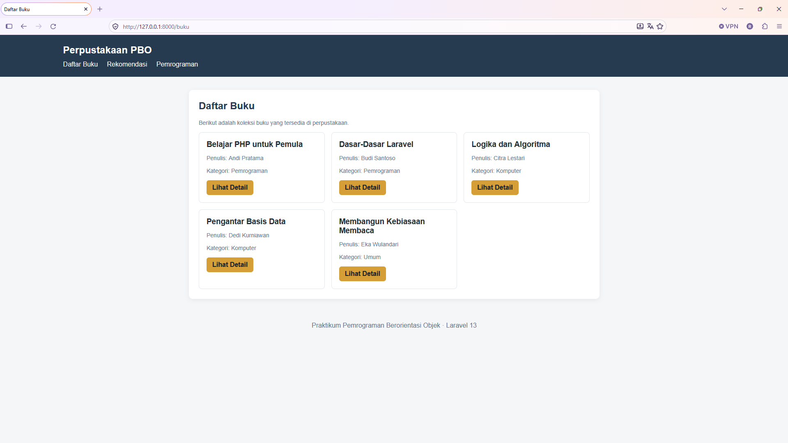
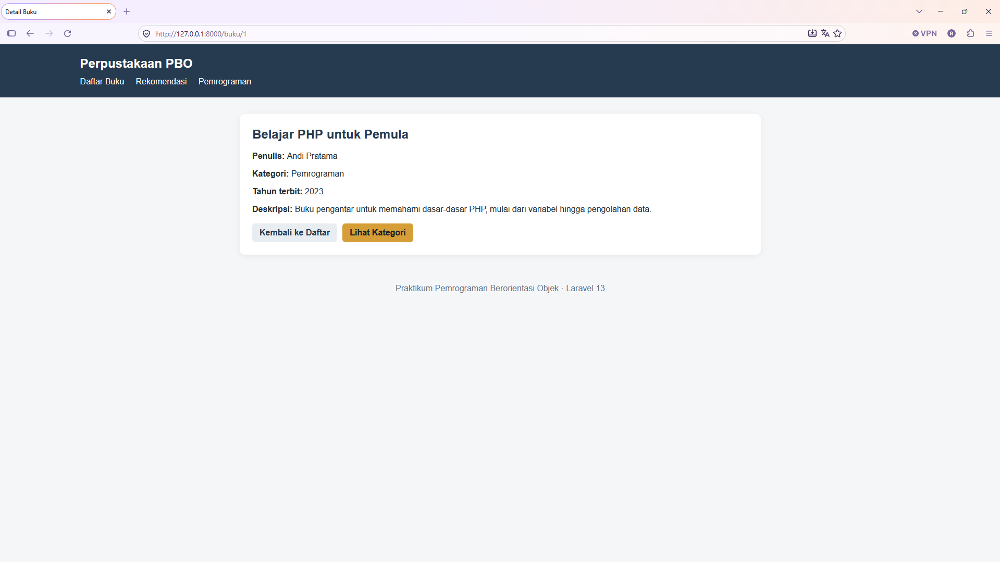
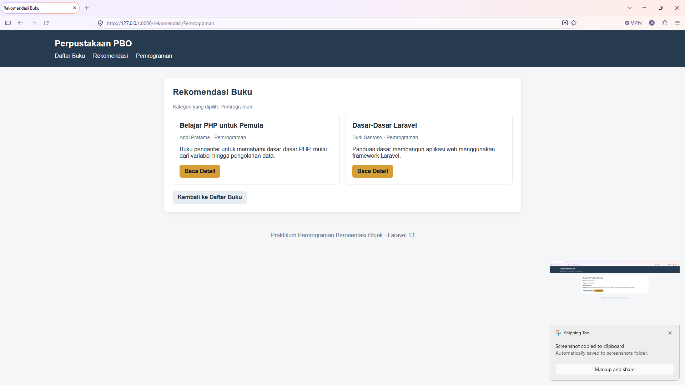

# Sistem Informasi Perpustakaan

Project ini merupakan penyelesaian tugas individu Pemrograman Berorientasi Objek dengan Laravel 13. Data buku disimpan sementara dalam array pada Controller, tanpa database.

## Fitur

- Menampilkan daftar buku pada `/buku`.
- Menampilkan detail buku pada `/buku/{id}`.
- Menampilkan rekomendasi seluruh buku pada `/rekomendasi`.
- Menampilkan rekomendasi berdasarkan kategori pada `/rekomendasi/{kategori}`.
- Menggunakan Route, Controller, Blade, named route, route parameter, `@if`, dan `@foreach`.

## Struktur file

Salin file pada folder project ini ke project Laravel 13 dengan struktur berikut:

- `routes/web.php`
- `app/Http/Controllers/BukuController.php`
- `resources/views/layouts/app.blade.php`
- `resources/views/buku/index.blade.php`
- `resources/views/buku/show.blade.php`
- `resources/views/buku/rekomendasi.blade.php`

## Cara menjalankan

1. Pastikan PHP, Composer, dan Laravel 13 sudah terpasang.
2. Buka terminal pada folder project Laravel.
3. Salin file dari folder solusi ini sesuai struktur di atas.
4. Jalankan perintah:

```bash
php artisan route:list --path=buku
php artisan serve
```

5. Buka `http://127.0.0.1:8000/buku`.

## Pengujian

| URL | Hasil yang diharapkan |
|---|---|
| `/buku` | Menampilkan daftar lima buku |
| `/buku/1` | Menampilkan detail Belajar PHP untuk Pemula |
| `/buku/2` | Menampilkan detail Dasar-Dasar Laravel |
| `/rekomendasi` | Menampilkan rekomendasi seluruh buku |
| `/rekomendasi/Pemrograman` | Menampilkan buku kategori Pemrograman |
| `/rekomendasi/Fiksi` | Menampilkan pesan bahwa buku untuk kategori tersebut belum tersedia |
| `/buku/99` | Menampilkan halaman 404 |

## Alur aplikasi

Browser mengirim request ke Route. Route meneruskan request ke method pada `BukuController`. Controller menyiapkan data buku dan mengirimkannya ke Blade View. Blade mengolah data menggunakan directive lalu menghasilkan HTML untuk ditampilkan pada browser.

## Screenshot pengumpulan





