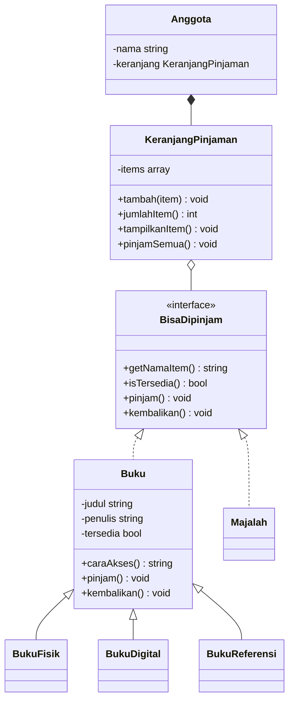
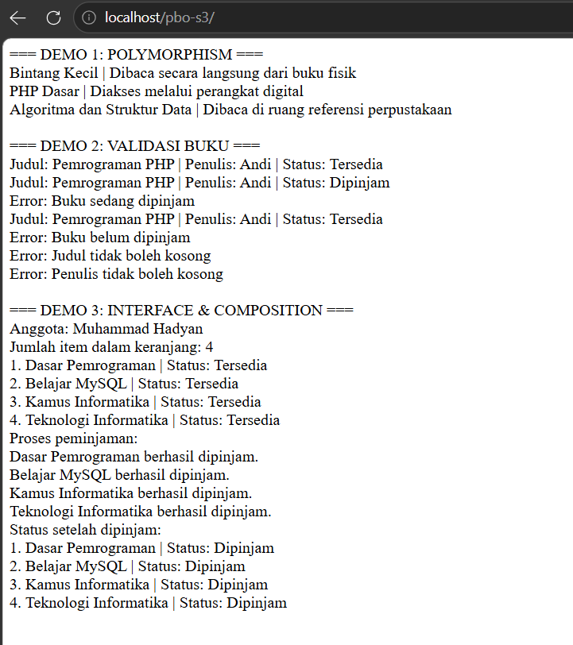

# Mini Application OOP — Sistem Peminjaman Perpustakaan

Proyek ini merupakan tugas **Pemrograman Berorientasi Objek (PBO) Pertemuan 5 — Advanced OOP**. Aplikasi berbasis PHP CLI ini mensimulasikan peminjaman buku dan majalah di perpustakaan, dengan melanjutkan class `Buku` dari tugas Pertemuan 4.

## Identitas

- **Nama:** Muhammad Hadyan
- **NIM:** 20251020050
- **Program Studi:** Teknik Informatika
- **Mata Kuliah:** Pemrograman Berorientasi Objek

## Latar Belakang

Perpustakaan memiliki beberapa jenis koleksi dengan cara akses yang berbeda. Namun, setiap item tetap membutuhkan aturan ketersediaan, peminjaman, dan pengembalian. Program ini memodelkan kebutuhan tersebut menggunakan konsep OOP agar kode dapat dikembangkan tanpa menghilangkan validasi dan encapsulation yang sudah diterapkan pada Pertemuan 4.

## Fitur

- Menyimpan data buku dengan judul, penulis, dan status ketersediaan.
- Mendukung tiga jenis buku: buku fisik, buku digital, dan buku referensi.
- Menampilkan cara akses yang berbeda berdasarkan jenis buku.
- Menerapkan aturan peminjaman dan pengembalian, termasuk penanganan kesalahan.
- Menyatukan buku dan majalah dalam keranjang pinjaman melalui interface.
- Menampilkan jumlah item dan status sebelum maupun setelah peminjaman.
- Memvalidasi agar judul buku, penulis, judul majalah, dan nama anggota tidak kosong atau hanya berisi spasi.

## Konsep OOP yang Diterapkan

| Konsep | Implementasi |
| --- | --- |
| Encapsulation | Property penting seperti `judul`, `penulis`, `tersedia`, `nama`, dan `items` dibuat `private`, lalu diakses melalui method yang sesuai. |
| Inheritance | `BukuFisik`, `BukuDigital`, dan `BukuReferensi` menggunakan `extends Buku`. |
| Overriding | Setiap subclass buku memiliki implementasi `caraAkses()` yang berbeda. |
| Polymorphism | Fungsi `tampilkanAkses(Buku $buku)` digunakan untuk menampilkan cara akses dari berbagai subclass tanpa `if/else` berdasarkan jenis buku. |
| Interface | `BisaDipinjam` menetapkan kontrak method `getNamaItem()`, `isTersedia()`, `pinjam()`, dan `kembalikan()`. Interface diimplementasikan oleh `Buku` dan `Majalah`. |
| Composition | `Anggota` membuat dan memiliki objek `KeranjangPinjaman`. Keranjang tersebut menyimpan beberapa item yang mengimplementasikan `BisaDipinjam`. |
| Exception handling | `InvalidArgumentException` dan `RuntimeException` digunakan untuk menangani data tidak valid serta peminjaman atau pengembalian yang tidak sesuai status. |

## Struktur Class



## Persyaratan

- PHP **7.4 atau lebih baru**.
- Terminal atau command prompt untuk menjalankan PHP CLI.
- Tidak memerlukan database, framework, maupun instalasi package tambahan.

Periksa instalasi PHP dengan perintah:

```bash
php -v
```

## Cara Menjalankan

1. Clone atau unduh repository ini.
2. Pastikan file `mini_aplikasi_pbo5.php` dan `README.md` berada di folder proyek yang sama.
3. Buka terminal pada folder proyek.
4. Periksa sintaks PHP:

   ```bash
   php -l mini_aplikasi_pbo5.php
   ```

5. Jalankan program:

   ```bash
   php mini_aplikasi_pbo5.php
   ```

Program akan menampilkan tiga bagian demo: **polymorphism**, **validasi dan encapsulation**, serta **interface dan composition**.

## Skenario Pengujian

| No. | Skenario | Hasil yang diharapkan |
| ---: | --- | --- |
| 1 | Membuat buku dengan data valid | Objek berhasil dibuat dengan status `Tersedia`. |
| 2 | Menampilkan cara akses tiga jenis buku | Setiap jenis buku menampilkan cara akses yang sesuai. |
| 3 | Meminjam buku yang tersedia | Status berubah menjadi `Dipinjam`. |
| 4 | Meminjam buku yang sudah dipinjam | Program menampilkan pesan `Buku sedang dipinjam`. |
| 5 | Mengembalikan buku yang belum dipinjam | Program menampilkan pesan `Buku belum dipinjam`. |
| 6 | Membuat buku dengan judul atau penulis kosong | Program menampilkan pesan validasi yang sesuai. |
| 7 | Menambahkan item ke keranjang | Buku fisik, buku digital, buku referensi, dan majalah dapat ditambahkan melalui interface `BisaDipinjam`. |
| 8 | Meminjam seluruh item pada keranjang | Program menampilkan hasil peminjaman dan status setiap item menjadi `Dipinjam`. |

## Hasil Program

Pada demo polymorphism, ketiga jenis buku menampilkan cara akses yang berbeda melalui fungsi yang sama. Pada demo validasi, program menguji peminjaman berulang, pengembalian yang tidak sesuai status, serta data kosong. Pada demo interface dan composition, empat item dimasukkan ke keranjang, kemudian diproses peminjamannya dan statusnya ditampilkan kembali.

## Output


## Refleksi

Pengembangan dari Pertemuan 4 menunjukkan bahwa inheritance dapat menggunakan kembali struktur serta validasi pada class `Buku`. Overriding memberi perilaku khusus pada setiap jenis buku, sedangkan polymorphism membuat fungsi pemanggil tetap sederhana. Interface memungkinkan buku dan majalah menjalankan kontrak peminjaman yang sama tanpa harus berada dalam hierarki class yang sama. Composition membuat `Anggota` dapat mengelola kumpulan item melalui `KeranjangPinjaman`.

## Kesimpulan

Aplikasi ini menerapkan inheritance, overriding, polymorphism, interface, composition, dan encapsulation dalam domain peminjaman perpustakaan. Validasi dan aturan peminjaman dari Pertemuan 4 tetap dipertahankan, sehingga program menjadi lebih mudah dikembangkan sekaligus menjaga konsistensi status item.
